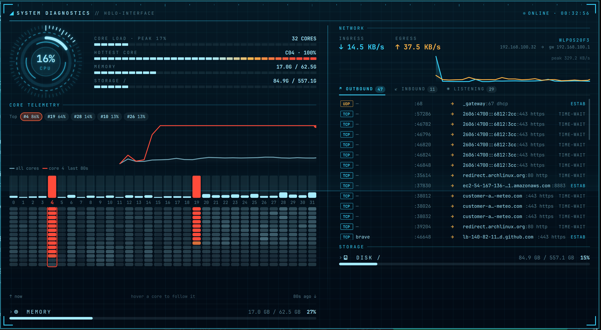

# Jarvis Meter

A holographic system monitor for the [Omarchy](https://omarchy.org/) bar.



The bar shows animated per-core CPU bars plus ring gauges for RAM and disk.
Hover it to open a holographic diagnostics HUD with:

- **Arc-reactor CPU gauge** with lit tick ring, counter-rotating segments and live
  readouts for core load, hottest core, memory and storage.
- **Core telemetry**: total vs. selected-core CPU chart, live per-core columns and
  an 80-second per-core heat-map history. Hover a core (or a "Top" chip) to follow it.
- **Memory**: processes sorted by resident memory, with size, share of RAM and
  live reordering. End (SIGTERM) or press-and-hold to force kill (SIGKILL) your
  own processes.
- **Network**: ingress/egress throughput chart and every socket split into
  Outbound / Inbound / Listening, with process, ports, service names and
  reverse-DNS hostnames.
- **Storage**: collapsible `du` tree with sizes and share of parent, infinite
  scroll, and move-to-Trash or press-and-hold permanent delete for folders in
  your home directory.

Colours shift from cyan through amber to red as load rises. Everything animates:
boot sequence on open, scanning line, ripples, sliding rows.

## Install

```bash
omarchy plugin add https://github.com/WarriorsSami/jarvis-meter.git --enable
```

Or enable it later with `omarchy plugin enable io.github.warriorssami.jarvis-meter`.

## Remove

```bash
omarchy plugin remove io.github.warriorssami.jarvis-meter
```

This removes the plugin folder and its bar entry. The plugin writes no files
outside its own folder.

## Settings

Add any of these to the widget's entry in `~/.config/omarchy/shell.json`:

| Setting        | Default | Meaning |
|----------------|---------|---------|
| `popupStyle`   | `"hud"` | `"hud"`, `"combined"`, `"dashboard"`, `"rings"` or `"graph"`. Non-`hud` styles use your theme colours. |
| `interval`     | `2000`  | Sample period in ms (minimum 500). |
| `disk`         | `"/"`   | Mount point shown for disk usage. |
| `coreBarWidth` | `2`     | Width of each per-core bar in the bar widget, in px. |

```json
{ "id": "io.github.warriorssami.jarvis-meter", "popupStyle": "hud", "interval": 2000 }
```

## Dependencies

Uses only tools present on a standard Omarchy install: `sh`, `cat`, `df`, `du`,
`ps`, `kill`, `rm`, `nice` (coreutils/procps), `ss` and `ip` (iproute2),
`getent` (glibc) and `gio` (glib2, for Trash). Qt modules: `QtQuick.Shapes`,
`QtQuick.Effects`.

## What it runs, and safety

- **Sampling**: reads `/proc/stat`, `/proc/meminfo`, `/proc/net/dev` and `df`
  every interval. `ps` and `ss` run every 3 s **only while the popup is open**.
  Folder sizes come from `nice du -d1`, only when you expand a folder.
- **Network lookups**: remote IPs are reverse-resolved with `getent hosts`
  (your system resolver). No other network requests are made.
- **Delete** is offered only for folders inside `$HOME` (never `$HOME` itself).
  The default action moves to Trash (`gio trash`); permanent delete
  (`rm -rf --one-file-system`) requires holding the button for 1.5 s.
- **Kill** is offered only for your own processes. Core session processes
  (Hyprland, the shell, systemd, uwsm, dbus, Xwayland, PipeWire, WirePlumber) are
  locked. Before signalling, the PID's name is re-checked so a recycled PID is
  never hit. Force kill requires a 1.5 s hold.
- Confirmations cancel themselves after 8 s.

## Notes

- Memory sizes are RSS, so shared pages count once per process.
- Sockets owned by root or other users show `—` instead of a process name.
- Preview mode (for screenshots/dev): `echo hud > "$XDG_RUNTIME_DIR/io.github.warriorssami.jarvis-meter.preview"`
  pins the popup open on the focused monitor; delete the file to stop.

Inspired by film-style holographic interfaces. Not affiliated with or endorsed
by Marvel or Disney.

## License

[MIT](LICENSE)
